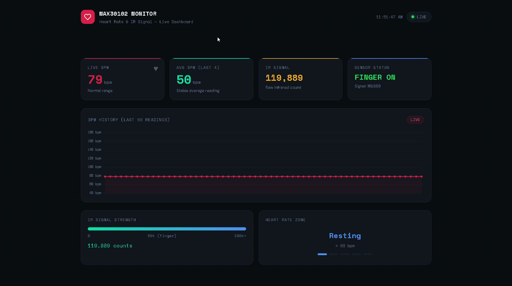

# Heart Rate Analysis — MAX30102 Live Dashboard

Real-time heart-rate monitoring with a **MAX30102** pulse sensor and an Arduino. The Arduino streams IR and BPM readings over serial, a small Python bridge exposes them over HTTP, and a browser dashboard plots them live.



▶ Demo video: [`media/demo.mp4`](media/demo.mp4)

## How it works

```
MAX30102 --I2C--> Arduino --USB serial--> bridge.py (Flask, :5000/data) --HTTP--> dashboard.html
```

1. **Firmware** reads the IR channel, detects beats, and prints `IR=... | BPM=... | Avg BPM=...` at 115200 baud.
2. **Bridge** parses those lines, tracks finger presence (IR ≥ 50000) and a rolling 60-point BPM history, and serves JSON at `http://localhost:5000/data`.
3. **Dashboard** polls the bridge every second and shows live BPM, average BPM, IR level, finger status and a BPM chart.

## Repository layout

```
heart-rate-max30102/
├── firmware/heart_ratemax30102/heart_ratemax30102.ino   Arduino sketch
├── bridge/bridge.py                                     serial → HTTP server
├── bridge/requirements.txt                              Python dependencies
├── dashboard/dashboard.html                             live browser dashboard
├── media/                                               demo video + screenshot
├── LICENSE                                              MIT
└── README.md
```

## Hardware

- MAX30102 pulse oximeter / heart-rate sensor module
- Arduino board with USB connection
- Jumper wires

| MAX30102 | Arduino |
|----------|---------|
| VIN      | 3.3 V (or 5 V if your module has a regulator) |
| GND      | GND     |
| SDA      | SDA (A4 on Uno) |
| SCL      | SCL (A5 on Uno) |

Adjust the pins for your board.

## Setup

### 1. Flash the Arduino
1. Install the **SparkFun MAX3010x Pulse and Proximity Sensor Library** via Arduino IDE → Library Manager (the sketch includes `MAX30105.h` and `heartRate.h`; this library supports the MAX30102 too).
2. Open `firmware/heart_ratemax30102/heart_ratemax30102.ino`, select your board and port, and upload.

### 2. Run the bridge
```bash
pip install -r bridge/requirements.txt
```
Open `bridge/bridge.py` and set `COM_PORT` to your Arduino's port (Arduino IDE → Tools → Port, e.g. `COM13` on Windows or `/dev/ttyUSB0` on Linux). **Close the Arduino Serial Monitor first** — only one program can use the port at a time.

```bash
python bridge/bridge.py
```
You should see `[bridge] Connected! Waiting for data...`.

### 3. Open the dashboard
Open `dashboard/dashboard.html` in any browser. Place your finger firmly on the sensor.

## Troubleshooting

| Symptom | Fix |
|---------|-----|
| `Could not open COM…` | Wrong `COM_PORT`, or Serial Monitor is still open |
| Dashboard says it cannot reach the bridge | `bridge.py` is not running |
| BPM shows `--` | Press your finger firmly on the sensor |
| `MAX30102 not found!` in serial output | Check wiring and I2C connections |

## Notes

- Readings are for learning and experimentation only — **not a medical device**.
- The dashboard loads Chart.js and Google Fonts from a CDN, so it needs an internet connection the first time.

## License

MIT — see [LICENSE](LICENSE).

## Author

Madav — ECE student, SASTRA University
